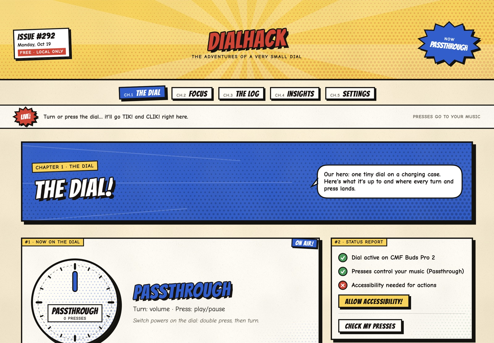
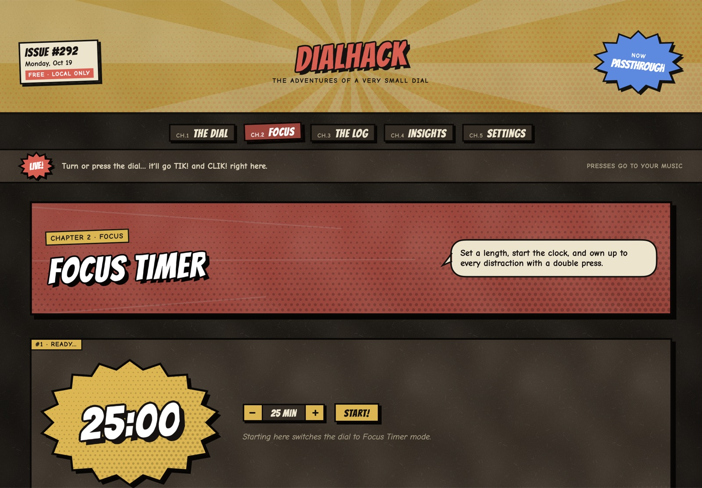
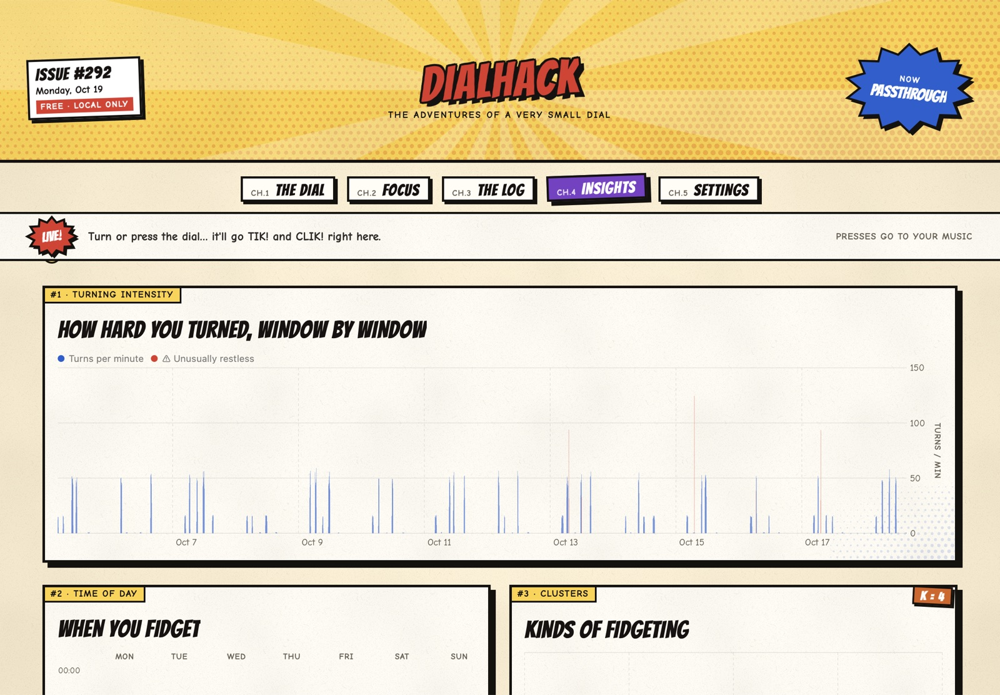

<p align="center"></p>

<h1 align="center">DialHack</h1>

<p align="center">
Turn the tiny Smart Dial on the <b>CMF Buds Pro 2</b> charging case into a general-purpose input device for your Mac,<br>
and learn how you fidget along the way. Everything stays on your Mac.
</p>

<p align="center">
<a href="../../releases/latest/download/DialHack.zip"><b>⬇ Download DialHack for Mac</b></a>
&nbsp;·&nbsp; macOS 14+ · Apple Silicon
</p>



## What it does

- **Dial modes.** Double-press the dial, then turn it to pick a mode:
  - **Scroll:** scroll any app, a few lines per click.
  - **Scrub:** seek through video (←/→), with play/pause on press.
  - **Combo Lock:** dial in a code.
  - **Macros:** run a shortcut, open an app or run a script.
  - **Passthrough:** the dial goes back to being a volume knob.
- **Your volume stays put.** In dial modes DialHack uses the volume signal as input, then puts your volume back after every click.
- **Focus Timer.** Turn to set the minutes and press to start. Double-press whenever you get distracted, and rate the session at the end.
- **Fidget insights.** Every turn and press is logged locally. You get a weekday × hour heatmap, clusters of "kinds" of fidgeting, unusually restless stretches, and a classifier that has to beat an always-guess-the-most-common-label baseline before it's shown as useful.
- **A comic-book look.** It has chapters and speech bubbles, every click shows up as a sound effect (TIK! TAK! CLIK!), and a textured "night paper" theme follows dark mode.

| Focus Timer (dark mode) | Insights |
|---|---|
|  |  |

<sub>Screenshots use demo data.</sub>

## Install

1. [Download **DialHack.zip**](../../releases/latest/download/DialHack.zip) and unzip it.
2. Move **DialHack.app** to **Applications**.
3. Open it. DialHack isn't notarized by Apple (it's a free side project without a paid developer account), so macOS will block it the first time:
   - **macOS 15 and later:** after the warning, go to **System Settings → Privacy & Security**, scroll down and click **Open Anyway**.
   - **macOS 14:** right-click the app, choose **Open**, then **Open** again.
   - Or, in Terminal: `xattr -dr com.apple.quarantine /Applications/DialHack.app`
4. When asked, allow **Accessibility** (System Settings → Privacy & Security → Accessibility). DialHack needs it to post scroll and key events. It never reads your keyboard.
5. Connect your CMF Buds Pro 2 and turn the dial.

**Requirements:** a Mac with Apple Silicon running macOS 14 Sonoma or later, plus CMF Buds Pro 2 connected as the audio output. Intel Macs aren't supported yet.

**Privacy:** DialHack makes no network calls. Logs, labels and settings live in `~/Library/Application Support/DialHack`.

## How the dial works (what we measured first)

Before building anything, sniffers recorded what the dial actually sends to a Mac:

- One click is one volume step (1/16), and the buds send at most about one step every 300 ms.
- A single press is play/pause and a double press is "next track". Triple press and long press never reach the Mac.
- Taking an earbud out sends a stray "pause", which DialHack filters out.

Full protocol and results are in [docs/findings.md](dialhack/docs/findings.md).

## Build from source

No Xcode needed. The Command Line Tools are enough:

```bash
./dialhack/mac/DialHack/build.sh install   # runs the tests, builds, copies to /Applications
./dialhack/mac/DialHack/build.sh release   # builds dialhack/mac/DialHack/.build/DialHack.zip for a GitHub Release
```

## Project layout

- [mac/README.md](dialhack/mac/README.md): the DialHack app and the macOS sniffer (build, run, permissions)
- [android/README.md](dialhack/android/README.md): the Android sniffer. It's built but hasn't been tested on a phone yet.
- [analytics/](dialhack/analytics/): the Python pipeline (DuckDB, scikit-learn, Streamlit dashboard)
- [docs/BRIEF.md](dialhack/docs/BRIEF.md): the full project brief

Fonts: Bangers and Comic Neue (SIL Open Font License), bundled in the app.
